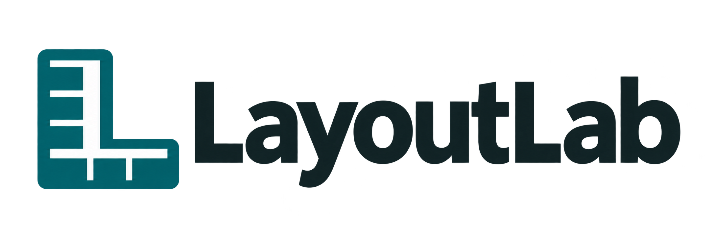
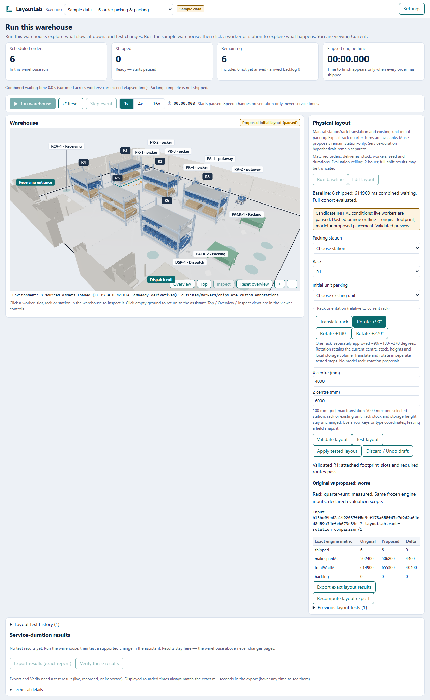
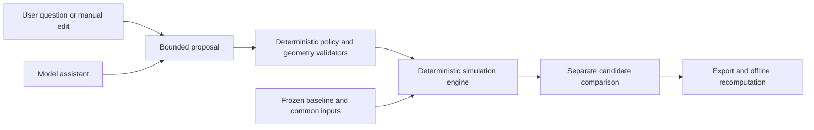

<p align="center"></p>

# Test warehouse changes before making them.

**[Watch the 2m20 demo](https://youtu.be/webE5e5WNbo)**

LayoutLab is a warehouse decision workspace: inspect an operation, propose a change, and compare it with a preserved baseline using reproducible measurements.

[Open the workspace](https://layoutlab.endpx.cloud) · [Judge guide](docs/JUDGES_GUIDE.md) · [Demo](docs/DEMO.md) · [Documentation](docs/README.md)



## Inspect, propose, compare, verify

Run the synthetic warehouse and inspect workers, stations, orders and waiting. Translate racks or packing stations, rotate racks in quarter-turns, or change initial parking. Validate and test a separate candidate, compare original and proposed measurements, then apply a compatible tested layout or discard it. Export and recompute the comparison from saved inputs.

For example, a historical live Meta investigation used three model requests to test service-duration assumptions. The six-order baseline finished in **502,400 ms**, versus **397,100 ms** under a selected **30-second dispatch** assumption. This is hypothetical synthetic performance, not measured facility savings or a physical-layout improvement.



The user or model proposes; validators enforce allowed changes and the engine computes measurements. Inputs stay matched except for the permitted intervention. The legacy storage-assignment planner remains an advanced compatibility workflow.

## Native quickstart

Tested on **Node v24.18.0**; manifest range: `^22.12.0 || ^24.0.0 || >=26.0.0`. No Docker required.

```sh
npm ci
npm run build
npm start
```

Open `http://127.0.0.1:3001/`. Sample/manual controls and replay need no key. Development uses `npm run dev` and `npm run dev:api` in separate terminals. See [local runtime](docs/LOCAL_RUNTIME.md).

## Evidence and current scope

| Record | What it establishes |
|---|---|
| [Live operations report](evidence/sanitized/e4a-live-investigation-f24a6a1.json) | 3 actual Meta requests; synthetic service-duration investigation |
| [Live storage benchmark](evidence/sanitized/m5-benchmark-live.md) | 18 runs, 72 requests, 54 attempts: 38 valid, 16 unparseable; beat heuristic in 2 runs; all outcomes retained |
| [Layout assistant](docs/LAYOUT_ASSISTANT_REVIEW.md) | Bounded packing translation; HTTP fixture proof, not live physical-layout inference |
| [Gater integration](docs/GATER_INTEGRATION.md) | Local glm-5-3-flash fixtures; no real completion or deployment proof |
| [Deployment record](docs/PUBLIC_DEPLOYMENT.md) | Release and anonymous review history, including earlier failures |

> Last verified public application: `c1ac299`, with animated clothed workers, aligned carts/carried cargo, the unified workspace, manual translations, rack quarter-turns, initial parking, separate candidates and export/recompute. Source milestone `574eee8` added fixture-tested Gater support; that code is now included in the release, and the public runtime now uses Gater `glm-5-3-flash`; real local provider calls and engine-tested service candidates are recorded in [the live review](docs/GATER_LIVE_REVIEW.md). Sample/replay/manual controls are anonymous; paid routes require Basic Auth. The app allowance is explicitly unlimited, but the latest public inference attempt was rejected by Gater with `IP_LIMIT_REACHED`; provider IP access must be opened before live runs can succeed. Judges can review and verify recorded examples without a key.

Worker animation follows engine distance and heading. Traffic still reserves cart footprints; turns are instantaneous, and archived reports without segment telemetry use a stable worker pose. See the [human visualization release](docs/HUMAN_VIEWER_INTEGRATION.md) and [public verification](evidence/sanitized/human-public/smoke.json).

Stubs and HTTP fixtures prove integration behavior, not live inference. Historical Meta reports retain their provider identity. Replay establishes measurement consistency, not authenticated provider provenance.

## Repository map

| Location | Responsibility |
|---|---|
| [apps/web](apps/web) | Interactive workspace |
| [apps/api](apps/api) | Server-side proposals and reports |
| [packages/core](packages/core) | Storage evaluation and replay |
| [packages/simulation](packages/simulation) | Deterministic operations engine |
| [scripts](scripts) | Verification tooling |
| [docs](docs/README.md) | Product, methodology and reviews |
| [evidence/sanitized](evidence/sanitized) | Curated reports and captures |

Workspace readability and renderer release: [quality review](docs/WORKSPACE_QUALITY.md).

Read [methodology](docs/METHODOLOGY.md), [evaluation](docs/EVALUATION.md) and [limitations](docs/LIMITATIONS.md). Assets have [license records](assets/licenses) and [provenance](docs/ASSET_PROVENANCE.md); no code license is declared here.

The demonstrated simulation is cart-based; human physics drafts are outside this milestone. Synthetic geometry is not safety certification. Results establish neither real-facility validation, global optimality nor universal Meta superiority. Equal-budget AI contribution and warehouse realism remain open work.
